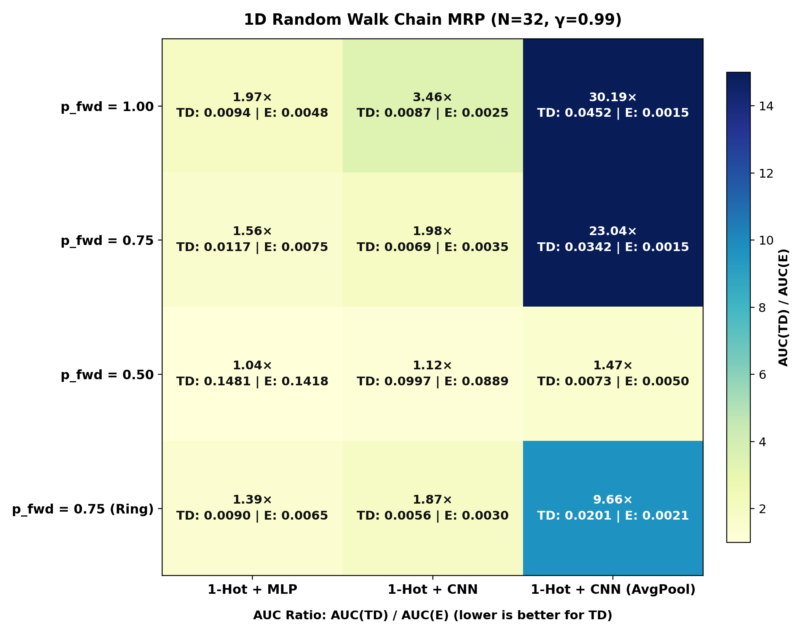

# Investigation into $\text{TD}$ vs. $E$-Minimization

## Experiment 1: Value Function Learning on a 1D Random-Walk Chain

### Motivation & Setup
Before introducing any formal theory, we start with a simple motivating experiment: **value function learning for a fixed Markov Reward Process (MRP)** on a 1D chain of $N = 32$ states ($s \in \{0, 1, \dots, 31\}$, $\gamma = 0.99$).

* **Environment (1D Chain with Drift $p_{\text{fwd}}$):**  
  At each step, the process moves forward ($s \to s+1$) with probability $p_{\text{fwd}}$ and backward ($s \to s-1$) with probability $1 - p_{\text{fwd}}$. State $0$ reflects backward steps back to $0$, and moving forward out of state $31$ ends the episode with reward $+1.0$ (and resets to $0$ in the state-visitation distribution).
  * $p_{\text{fwd}} = 1.00$: purely one-way forward walk.
  * $p_{\text{fwd}} = 0.75$: biased forward walk.
  * $p_{\text{fwd}} = 0.50$: symmetric random walk.
* **Fixed Observation:**  
  Every state is represented identically as a 32-dimensional **one-hot** vector indicating the agent's position on the chain.
* **Three Neural Networks (Increasing Spatial Sharing):**
  1. **`1-Hot + MLP`**: standard multilayer perceptron (`core.networks.MLP`). Each position has its own independent input weights.
  2. **`1-Hot + CNN`**: 1D convolutional network (`kernel_size = 5`) over the one-hot strip, introducing local weight sharing across nearby positions.
  3. **`1-Hot + CNN (AvgPool)`**: adds a spatial average-pooling layer (`window = 7`) before the convolution, blurring adjacent one-hot positions so neighboring states strongly overlap.
* **Training:**  
  We compare exact expected `TD(0)` and exact expected `E(0)` using Adam for 1,500 steps (5 seeds, best learning rate tuned per cell from $\{10^{-4}, 3\times 10^{-4}, 10^{-3}, 3\times 10^{-3}, 10^{-2}\}$), measuring the area under the relative value MSE curve (`AUC`).

Reproducible script: [`scripts/chain_demo_1.py`](scripts/chain_demo_1.py)

---

### Results

### Key Observations
1. **Both asymmetry and spatial feature sharing are needed for a large gap:**
   * When the chain is symmetric ($p_{\text{fwd}} = 0.50$), `TD(0)` and `E(0)` perform almost identically across every network (`1.04×`, `1.12×`, `1.47×`).
   * As the chain becomes directional ($p_{\text{fwd}} = 0.75 \to 1.00$) **and** the network blurs neighboring states together (`MLP` $\to$ `CNN` $\to$ `CNN + AvgPool`), **`E(0)` improves while `TD(0)` degrades sharply**—reaching a **`23×`–`30×`** AUC gap with average pooling.
2. **Average pooling helps `E(0)` but hurts `TD(0)` under drift:**
   Looking across the top row ($p_{\text{fwd}} = 1.00$), adding spatial pooling cuts `E(0)`'s error (`0.0048 -> 0.0025 -> 0.0015`) while making `TD(0)` nearly **5× worse** (`0.0094 -> 0.0452`).
