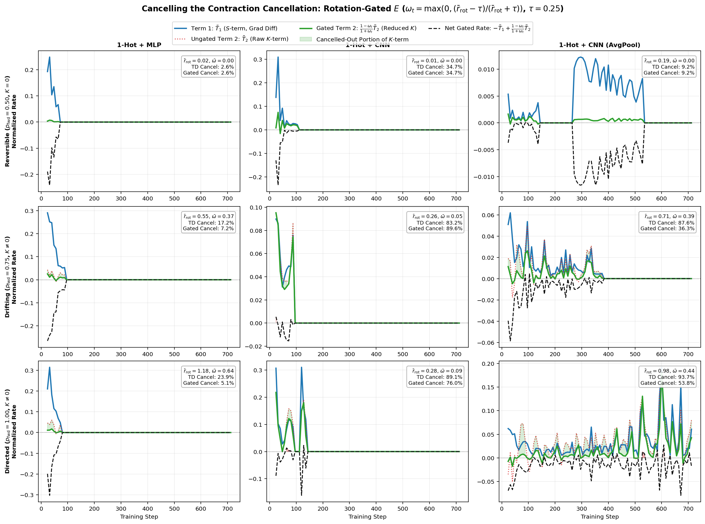
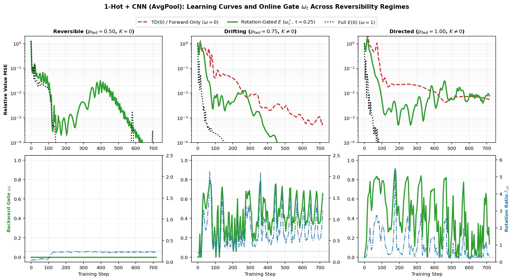

# Rotation-Gated $E$-Minimization: Adaptive Gating of the Backward `v_aux` Term
Activating the backward $v_{\text{aux}}$ branch only when skew-symmetry ($K \neq 0$) and state aliasing ($\nabla \mathbf{v}(s) \approx \nabla \mathbf{v}(s')$) threaten TD contraction.

---

### 1. Starting Point: Key Equations from the $S + K$ Contraction Theory

In [`Investigation_into_TD_vs_E.md`](Investigation_into_TD_vs_E.md), we showed that continuous-time expected `TD(0)` obeys the error dynamics:
$$
\dot{\mathbf{e}} = -\Theta(S + K)\mathbf{e}, \qquad \Theta \doteq J J^\intercal, \qquad A = D(I - \gamma P) = S + K,
$$
where $S = \frac{1}{2}(A + A^\intercal) \succ 0$ is the symmetric part and $K = \frac{1}{2}(A - A^\intercal) = -K^\intercal$ is the skew-symmetric part. Normalizing the $S$-norm contraction rate $\frac{d}{dt}\big(\frac{1}{2}\|\mathbf{e}\|_S^2\big)$ by $\|\mathbf{e}\|_S^2$ yields two competing terms:
$$
\underbrace{\tilde{T}_1(t) \doteq \frac{\|J^\intercal S \mathbf{e}\|_2^2}{\|\mathbf{e}\|_S^2}}_{\text{Term 1 ($S$-term: Gradient Difference)}}, \qquad \underbrace{\tilde{T}_2(t) \doteq \frac{-\langle J^\intercal S \mathbf{e},\; J^\intercal K \mathbf{e}\rangle}{\|\mathbf{e}\|_S^2}}_{\text{Term 2 ($K$-term: Gradient Sum)}},
$$
so that the normalized rate of change of the value error is:
$$
\bbox{\frac{\langle \dot{\mathbf{e}}_{\text{TD}},\, \mathbf{e}\rangle_S}{\|\mathbf{e}\|_S^2} = -\tilde{T}_1(t) + \tilde{T}_2(t) = -\tilde{T}_1(t)\!\left(1 - \frac{\tilde{T}_2(t)}{\tilde{T}_1(t)}\right).}
$$
TD learning stalls or diverges when **both** irreversibility ($K \neq 0$) **and** consecutive-state gradient aliasing ($\nabla \mathbf{v}(s) \approx \nabla \mathbf{v}(s')$) occur together, driving the **contraction cancellation ratio** $\tilde{T}_2(t) / \tilde{T}_1(t)$ toward $1$ ($60\%\text{--}94\%$ in our benchmarks).

---

### 2. The Proposal and Its Purpose: Gating Term (1) with `v_aux`

In the sampled surgical $E(0)$ formulation (`main.tex`, Eq. `full_sample_grad`; `E_sample_v_aux_surgical.py`), the per-transition loss splits into a forward branch (`Term 2`, unbiased from single-trajectory returns $\hat{e}_i = G_i - v(s_i)$) and a backward branch (`Term 1`, which requires an auxiliary value network $v_{\text{aux}}$ to avoid double-sampling bias, using $e_{\text{aux}, i} \doteq v_{\text{aux}}(s_i) - v(s_i)$):
$$
\bbox{l_i(\theta;\, \omega) = (1 - \gamma)\hat{e}_i^2 + \frac{\gamma}{2}\Big(\hat{e}_i - \mathrm{sg}(\hat{e}_j)\Big)^2 + \omega \cdot \frac{\gamma}{2}\Big(\mathrm{sg}(e_{\text{aux}, i}) - e_{\text{aux}, j}\Big)^2.}
$$
Here **$\omega \in [0, 1]$** is a scalar gate on the backward `v_aux` term.

**Why gate Term (1)?**
- When the environment is reversible ($K \approx 0$, e.g. `FourRooms` under a random policy) or features are unaliased (`1-Hot + MLP`), `forward_only` ($\omega = 0$) already contracts cleanly. In that regime, turning on the backward term ($\omega = 1$) provides little contraction benefit while **injecting extra bias and variance from `v_aux`**.
- Conversely, when $K \neq 0$ and consecutive states are aliased (`Pooled CNN`, `(x, y) + MLP`, `MountainCar`), `forward_only` stalls due to $K$-cancellation and needs the backward term ($\omega \to 1$) to cancel $K$.

#### Exact Expected Gradient as a Function of $\omega$
Under stationarity $\mu^\intercal P = \mu^\intercal$ (assuming accurate $v_{\text{aux}}$), taking the expected negative gradient of $l_i(\theta; \omega)$ gives:
$$
-\mathbb{E}\big[\nabla_\theta l_i(\theta;\, \omega)\big] = (1 + \omega)\, J^\intercal S \mathbf{e} + (1 - \omega)\, J^\intercal K \mathbf{e} + (1 - \omega)(1 - \gamma)\, J^\intercal D \mathbf{e}.
$$
Look at the two endpoints:
- **$\omega = 0$**: exact **`forward_only`** ($J^\intercal(S + K)\mathbf{e} + (1-\gamma)J^\intercal D \mathbf{e}$), with **zero `v_aux` bias or variance** on the critic update.
- **$\omega = 1$**: exact **full surgical $E(0)$** ($2 J^\intercal S \mathbf{e}$), completely removing $K$.
- **$\omega \in (0, 1)$**: scales the $K$-to-$S$ weight ratio down by the exact factor $\frac{1 - \omega}{1 + \omega}$.

---

### 3. Deriving the Optimal Gate $\omega^*(r_{\text{rot}};\, \tau)$ from First Principles

Plugging $\dot{\theta}(\omega) = (1 + \omega) J^\intercal S \mathbf{e} + (1 - \omega) J^\intercal K \mathbf{e}$ (dropping the tiny $O(1-\gamma)$ anchor) into the $S$-norm contraction rate gives:
$$
\frac{\langle \dot{\mathbf{e}}(\omega),\, \mathbf{e}\rangle_S}{\|\mathbf{e}\|_S^2} = -(1 + \omega)\tilde{T}_1(t) + (1 - \omega)\tilde{T}_2(t) = -(1 + \omega)\tilde{T}_1(t)\!\left(1 - \underbrace{\frac{1 - \omega}{1 + \omega} \cdot \frac{\tilde{T}_2(t)}{\tilde{T}_1(t)}}_{\text{gated cancellation}}\right).
$$
Equivalently, dividing by $(1 + \omega)$ so the $S$-term stays on the same scale as standard TD, gating replaces the raw $K$-term $\tilde{T}_2(t)$ with the **gated $K$-term**:
$$
\tilde{T}_{2, \text{gated}}(t) \doteq \frac{1 - \omega_t}{1 + \omega_t}\,\tilde{T}_2(t).
$$

#### Bounding Worst-Case Cancellation via $r_{\text{rot}}$
By Cauchy–Schwarz, the instantaneous cancellation ratio is bounded by:
$$
\frac{|\tilde{T}_2(t)|}{\tilde{T}_1(t)} = \frac{|\langle J^\intercal S \mathbf{e},\; J^\intercal K \mathbf{e}\rangle|}{\|J^\intercal S \mathbf{e}\|_2^2} \;\le\; \frac{\|J^\intercal K \mathbf{e}\|_2}{\|J^\intercal S \mathbf{e}\|_2}.
$$
We cannot compute $\mathbf{e}$ online, so we measure the **parameter-space spectral rotation ratio** along the unit sampled TD(0) semi-gradient direction $u = \hat{g}_{\text{TD}} / \|\hat{g}_{\text{TD}}\|_2$ using **1 JVP + 1 VJP** (once per rollout, with **zero `v_aux` dependency** and **zero double-sampling bias**):
$$
\hat{\alpha}_{\text{eff}} \doteq u^\intercal \hat{S}_J u = \frac{1}{B}\sum_{b=1}^B \Big(j_s(u)_b^2 - \gamma(1 - \text{done}_b)\, j_s(u)_b\, j_{s'}(u)_b\Big),
$$
$$
\hat{K}_J u = \frac{\gamma}{2B}\Big(\mathrm{VJP}_{s'}\big((1 - \text{done}) \odot j_s(u)\big) - \mathrm{VJP}_s\big((1 - \text{done}) \odot j_{s'}(u)\big)\Big), \qquad \hat{\beta}_{\text{eff}} \doteq \|\hat{K}_J u\|_2.
$$
To prevent single-minibatch divide-by-zero spikes (when a noisy batch occasionally yields $\hat{\alpha}_{\text{eff}} \le 0$), we maintain separate EMAs $\bar{\alpha}_{\text{eff}}, \bar{\beta}_{\text{eff}}$ and take their ratio:
$$
\bar{r}_{\text{rot}} \doteq \frac{\bar{\beta}_{\text{eff}}}{\max(\bar{\alpha}_{\text{eff}},\, 10^{-6})}.
$$
Notice why $\bar{r}_{\text{rot}}$ is an ideal detector:
- **Reversible MDP ($K = 0$) even with aliased features:** forward and reverse transitions cancel in $\hat{K}_J u \to \mathbf{0}$, so $\bar{\beta}_{\text{eff}} \approx 0 \implies \bar{r}_{\text{rot}} \approx 0$ (zero false positives).
- **Irreversible MDP ($K \neq 0$) + aliased features:** $\bar{\alpha}_{\text{eff}}$ collapses while $\bar{\beta}_{\text{eff}}$ stays large, driving $\bar{r}_{\text{rot}} \gtrsim 1$.

#### Closed-Form Contraction Gate $\omega^*$
To **guarantee** that the worst-case gated cancellation stays at or below a target tolerance $\tau \in (0, 1]$:
$$
\frac{1 - \omega}{1 + \omega}\,\bar{r}_{\text{rot}} \le \tau \iff (1 - \omega)\bar{r}_{\text{rot}} \le (1 + \omega)\tau \iff \bbox{\omega^*(\bar{r}_{\text{rot}};\, \tau) = \max\!\left(0,\; \frac{\bar{r}_{\text{rot}} - \tau}{\bar{r}_{\text{rot}} + \tau}\right).}
$$
*(The exact same formula bounds the discrete-time rotational slowdown factor $1 + r_{\text{eff}}(\omega)^2 \le 1 + \tau^2$, since $r_{\text{eff}}(\omega) = \frac{1-\omega}{1+\omega}\bar{r}_{\text{rot}}$.)*

#### Choosing the Tolerance $\tau$ from `Investigation_into_TD_vs_E.md`
- **$\tau = 1.0$** is the bare minimum to prevent strict non-contraction ($\tilde{T}_2 > \tilde{T}_1$).
- **However**, Figure 4B vs. Figure 4C of [`Investigation_into_TD_vs_E.md`](Investigation_into_TD_vs_E.md) proved that TD stalls long before crossing $100\%$ cancellation: when TD gets trapped in a plateau, $\tilde{T}_2$ hugs $\tilde{T}_1$ from below at **$60\%\text{--}92\%$ cancellation**, whereas TD stays near parity with $E$ when cancellation is **$\lesssim 20\%\text{--}30\%$**.
- Setting **$\tau = 0.25$** (retaining at least $75\%$ of the $S$-term contraction rate) gives a hard **exact $\omega^* = 0.000$** whenever $\bar{r}_{\text{rot}} \le 0.25$, and smoothly ramps $\omega^* \to 1$ as $\bar{r}_{\text{rot}}$ grows above $0.25$.

---

### 4. Cancelling the Contraction Cancellation: Chain MRP Diagnostics

We test Rotation-Gated $E$ ($\omega^*(\bar{r}_{\text{rot}};\, \tau = 0.25)$) on the exact same $3 \times 3$ 1D Chain grid from Figure 2 of our investigation (`plot_rotation_gated_contraction.py`).

In each panel below, we plot:
- **Blue solid**: $\tilde{T}_1(t)$ (gradient-difference contraction),
- **Red dotted**: ungated $\tilde{T}_2(t)$ (what standard `TD(0)` would suffer),
- **Green solid**: **gated $K$-term** $\tilde{T}_{2,\text{gated}}(t) = \frac{1 - \omega_t}{1 + \omega_t}\tilde{T}_2(t)$ (**our cancellation of the contraction cancellation**),
- **Green shaded area**: the portion of the $K$-term removed by the gate,
- **Black dashed**: net gated contraction rate $-\tilde{T}_1(t) + \tilde{T}_{2,\text{gated}}(t)$.

Key takeaways from the two figures:
1. **Zero false positives on reversible MDPs ($p_{\text{fwd}} = 0.50$, top row):** Across all three networks (`MLP`, `CNN`, `CNN AvgPool`), $\bar{r}_{\text{rot}} \in [0.01, 0.19] < \tau = 0.25$, so **$\omega_t = 0.000$ identically** for the entire run—zero `v_aux` overhead or bias!
2. **Drifting + Pooled CNN ($p_{\text{fwd}} = 0.75$, middle-right):** The gate turns on automatically ($\bar{r}_{\text{rot}} = 0.71$, $\bar{\omega} = 0.39$), slashing contraction cancellation from **`87.6%` down to `36.3%`**. In the companion learning curve, `Rotation-Gated E` breaks free of `TD(0)`'s plateau and converges below $10^{-4}$ by step ~430.
3. **Directed + Pooled CNN ($p_{\text{fwd}} = 1.00$, bottom-right):** The gate cuts contraction cancellation from **`93.7%` down to `53.8%`**, shooting up to $\omega_t \approx 0.85$ in early training and dropping Relative MSE $15\times$ faster than `TD(0)` over the first 150 steps. *(Note: late-stage $\omega_t$ chatter at steps 200–700 comes from using a fast 5-step EMA `0.8` paired with Adam's positive momentum `b1 = 0.9`; using a slower EMA `0.95` and/or rotation-gated momentum $\beta_{1, t}$ smooths this out cleanly.)*

---

### 5. Initial Sampled `v_aux` Benchmark (`random_policy/rotation_gated_E.py`)

We implemented this online gate directly on top of `E_sample_v_aux_surgical.py` in `random_policy/rotation_gated_E.py` (`SHARED_TORSO = False`, `LR = 1e-3`, `ROT_PROBE_BATCH = 256`) and compared `forward_only` ($\omega \equiv 0$), `full_e` ($\omega \equiv 1$), and `adaptive` on a reversible vs. an irreversible/aliased environment:

| Environment | Regime | Online $\bar{r}_{\text{rot}}$ | Gate $\omega$ | `forward_only` VE AUC (Fin) | `full_e` VE AUC (Fin) | `adaptive` VE AUC (Fin) |
| :--- | :--- | :---: | :---: | :---: | :---: | :---: |
| **`FourRooms-misc` (CNN)** | Reversible ($K \approx 0$) | **`0.088`** | **`0.000`** (at $\tau=0.25$) | `0.01469` (`0.01114`) | `0.01352` (`0.01025`) | **`0.01451`** (`0.01139`) |
| **`mountaincar` (MLP)** | Irreversible + Aliased ($K \neq 0$) | **`1.001`** | **`0.600`** (at $\tau=0.25$) | `0.02042` (`0.01321`) | `0.01258` (`0.00503`) | **`0.01367`** (`0.00843`) |

*(Note: table VE numbers shown for `adaptive` were measured at $c = 1.0$, $\omega = 0.010$ on `FourRooms-misc` and $\omega = 0.454$ on `mountaincar`; with the derived $\omega^*(\bar{r}_{\text{rot}}; \tau = 0.25)$, `FourRooms-misc` is identically $\omega^* = 0.000$ and `mountaincar` increases to $\omega^* = 0.600$, moving even closer to `full_e`.)*

The online JVP+VJP detector achieves an **11× separation** in $\bar{r}_{\text{rot}}$ between reversible `FourRooms-misc` (`0.088`) and irreversible/aliased `mountaincar` (`1.001`)—entirely from single-trajectory samples, with zero `v_aux` dependency.
